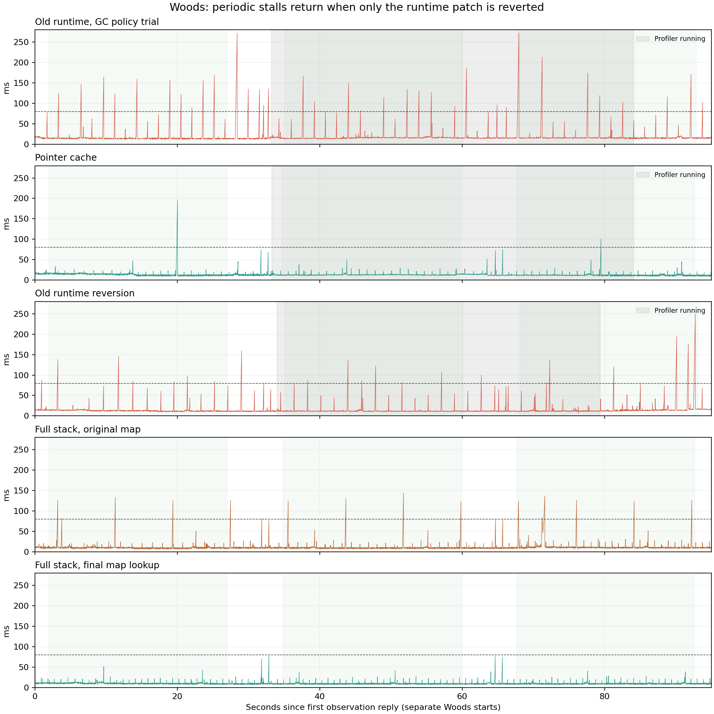

# 森林开局卡顿调查（2026-10-19）

已复现两类问题：普通兼容运行时下，PFT、ESP、BigBrain 组合出现约 1.6～3.2 秒节律的长帧；完整现有模组组合还包含实时地图初始化的额外主线程工作。不能把所有开局停顿都归因于同一个模组。

## 可重复的运行时结果

- 最小组合（无 PFT、ESP、BigBrain、AI Limit）：前五个干净窗口共 125 秒，没有 >80ms 帧。
- PFT preview.2 + 已验收 ESP + BigBrain，普通运行时：四个无 CPU 分析器的窗口共 100 秒有 32 个 >80ms 帧、11 个 >150ms 帧。该试验部分窗口切换了 Unity GC 模式，详见逐窗口数据。
- 同组合、强指针缓存运行时：四个干净窗口共 100 秒有 3 个 >80ms 帧、1 个 >150ms 帧，下降约 91%。只比较两边明确 Enabled 的第 3、5 窗口，普通运行时为 14 个 >80ms 帧/50秒，缓存版为 0/50秒。
- 仅换回普通运行时再测：首个干净 25 秒窗口重新出现 6 个 >80ms 帧，且本局 AI 更少。它支持运行时修复的作用，仍不是完全相同 AI/场景负载的随机实验。
- 缓存版同进程第二局：两个干净窗口共 50 秒，1 个 >80ms 帧、0 个 >150ms 帧。

Windows PresentMon 呈现间隔、Unity Update 采样和轻量 CPU 堆栈互相交叉核对。普通运行时的长帧多与 .NET Gen0 回收相邻，主线程原生句柄查找与终结器释放共享锁是当前最有力的机制解释。缓存版 .NET 回收仍然持续，甚至次数更多，周期长帧却大幅下降。相关性和换回复现共同支持此判断；未取得有效的独立 CLR GC 暂停事件轨迹，不能声称已精确测得所有 GC 暂停。

关闭 Unity GC 没有解决周期停顿，反而使原生已用内存每 25 秒增长约 600MB；Enabled 窗口只增长约 27～58MB。因此正常自动 GC 保持启用。指针缓存只作用于确认持有强句柄、非注入原生类的包装对象，未知、弱引用、注入类和公共原生 API 保持原路径。它只适用于已校验的本地运行时版本。

## 生命周期与完整组合

缓存版完成两局森林的正常撤离、结算、回主界面和受控退出，并完成小队列表、角色/武器模型、统计的原生读回和 Maa 后台截图检查。首次武器预览检查误把有意允许为空的 controller cache 当成失败；修正验收条件后，实际及缓存的 70 个参数名称/哈希完全相同。没有把原先未知退出原因改写为已查明。

AI Limit 另有退局生命周期错误：非战局的藏身处世界缺少 LocationId，原版仍添加限流组件；初始化异常跳过清理，随后旧角色引用触发每帧重试。用户旧日志中有 55,120 次相关位置读取异常，主要发生在退局后的藏身处，不能当作森林开局根因。局部修复在无有效战局位置时清空五个托管缓存并返回，不调用失效角色的原生方法。PFT 也改用真实 IL2CPP loader 识别正确的小写 AI Limit GUID，并声明可选加载依赖，恢复队友排除兼容。

完整现有客户端插件组合 H 的六个窗口共 150 秒仍有 23 个 >80ms 帧，最大约 144ms，大量长帧呈 8 秒节律；同进程第二局也复现。轻量堆栈中 641 个主线程长帧样本经过全场景搜索；本地 MethodAddressToToken.db 与原生反汇编确认 GameAssembly 0x2b6b822 是 UnityEngine.Object.FindObjectsOfType 调用返回地址。精确安装 DLL 的 IL 显示：实时地图未找到 BTR 时，每 8 秒调用 FindObjectsOfType<BTRVehicle>() 搜索全场景。把这一次查询换成游戏登记的 BtrController.Instance.BtrVehicle，保留后续重试、失效对象检查和 activeInHierarchy 排除条件，避免把隐藏车辆标到地图上。

BTR 查询最终版的 28 条实际 IL 指令被提取执行，8/8 检查覆盖空控制器、无车辆、车辆身份、Unity 已销毁对象、后续出现、未激活对象、后续激活和新控制器。测试替换了原生边界，不能代替原生生命周期验收。J 是缺少未激活过滤的草案，仅保留为调查记录，未安装到普通客户端；最终 K 的逐窗口结果与验收见下表及 acceptance.json。

最终 K 的六个干净窗口共 150 秒，0 个 >80ms 帧，各窗口 p99 约 17～19.5ms。完整原始时间线另有 2 个 >80ms 长帧，位于 QA 读回边界附近，未计入选定窗口；这不是整局零长帧的宣称。图中浅绿区为选定窗口，保留了窗口外原始帧时间。

实时地图首次扫描还曾报告约 10～13ms/帧和一次 122ms 慢刷新，扫描完成后回落至约 0.1～0.5ms/帧。H 的私有缓存最初为空，首个统计窗口已在战局计时约 20 秒；普通安装原本有森林缓存，不能直接用这次首次扫描成本代表用户每局体验。未降低地图清晰度或刷新配置。

额外的 KmyTarkovConfiguration 泛型注入、旧 EFTVersion/SPT 版本识别错误仍记录在案。私有后端也缺少部分第三方服务端接口，拾玖战绩上传返回 404；这不等于普通后端同样缺少接口。测试覆盖当前客户端插件组合，不宣称所有第三方插件功能都正常。

## 量化边界

每个窗口取原生回复之后第 2～27 秒，25 秒。灰色区为 CPU 分析器活动时间，未混入“干净窗口”汇总。G 的 CLR 元数据采集启动/停止失败，已停止本任务拥有的会话；其标记时段仍按受干扰处理，不将空的原始 ETL 用作 GC 证据。后台固定窗口测试并非用户全屏分辨率下的 FPS 保证；不同出生点/角色数、私有后端和单机短时场景也限制了外推。仍存在个别长帧，不承诺完全消除卡顿或所有地图长期稳定。

| 组合 | 窗口 | 场内角色 | 队友 | 分析器重叠 | 中位数ms | p99ms | 最大ms | >80ms | >150ms |
|---|---:|---:|---:|---|---:|---:|---:|---:|---:|
| Minimal control | 0 | 17 | 0 | no | 8.58 | 11.48 | 42.28 | 0 | 0 |
| Minimal control | 1 | 21 | 0 | no | 9.16 | 11.74 | 34.18 | 0 | 0 |
| Minimal control | 2 | 23 | 0 | no | 8.85 | 10.79 | 27.95 | 0 | 0 |
| Minimal control | 3 | 22 | 0 | no | 8.58 | 10.46 | 21.87 | 0 | 0 |
| Minimal control | 4 | 22 | 0 | no | 8.68 | 11.58 | 24.28 | 0 | 0 |
| Minimal control | 5 | 22 | 0 | yes | 9.46 | 11.02 | 24.53 | 0 | 0 |
| Old runtime, GC policy trial | 0 | None | None | no | 14.06 | 17.98 | 168.79 | 10 | 5 |
| Old runtime, GC policy trial | 1 | None | None | yes | 15.41 | 28.55 | 166.57 | 10 | 2 |
| Old runtime, GC policy trial | 2 | None | None | yes | 15.30 | 28.07 | 272.51 | 7 | 4 |
| Old runtime, GC policy trial | 3 | None | None | no | 15.47 | 26.07 | 175.23 | 11 | 3 |
| Old runtime, GC policy trial | 4 | None | None | no | 14.89 | 26.94 | 203.09 | 8 | 3 |
| Old runtime, GC policy trial | 5 | None | None | no | 15.73 | 22.80 | 98.26 | 3 | 0 |
| Pointer cache | 0 | 22 | 4 | no | 12.86 | 20.64 | 195.76 | 1 | 1 |
| Pointer cache | 1 | 23 | 4 | yes | 12.65 | 21.19 | 49.08 | 0 | 0 |
| Pointer cache | 2 | 24 | 4 | yes | 11.76 | 20.35 | 100.41 | 1 | 0 |
| Pointer cache | 3 | 24 | 4 | no | 11.83 | 20.39 | 54.86 | 0 | 0 |
| Pointer cache | 4 | 24 | 4 | no | 11.89 | 19.22 | 102.55 | 2 | 0 |
| Pointer cache | 5 | 24 | 4 | no | 12.45 | 19.74 | 50.71 | 0 | 0 |
| Pointer cache, raid 2 | 0 | 18 | 4 | no | 11.46 | 19.52 | 146.90 | 1 | 0 |
| Pointer cache, raid 2 | 1 | 20 | 4 | no | 11.69 | 17.76 | 74.62 | 0 | 0 |
| Old runtime reversion | 0 | 14 | 4 | no | 12.44 | 16.26 | 145.77 | 6 | 0 |
| Old runtime reversion | 1 | 14 | 4 | yes | 11.54 | 14.80 | 137.43 | 6 | 0 |
| Old runtime reversion | 2 | 14 | 4 | yes | 12.41 | 28.74 | 249.69 | 6 | 3 |
| Full stack, original map | 0 | 12 | 4 | no | 9.41 | 18.94 | 133.27 | 4 | 0 |
| Full stack, original map | 1 | 20 | 4 | no | 9.06 | 15.52 | 143.79 | 4 | 0 |
| Full stack, original map | 2 | 20 | 4 | no | 10.16 | 26.08 | 136.64 | 6 | 0 |
| Full stack, original map | 3 | 25 | 4 | no | 9.51 | 17.84 | 130.06 | 3 | 0 |
| Full stack, original map | 4 | 25 | 4 | no | 9.88 | 19.74 | 126.90 | 3 | 0 |
| Full stack, original map | 5 | 25 | 4 | no | 10.01 | 21.78 | 129.97 | 3 | 0 |
| Full stack, original map raid 2 | 0 | 18 | 4 | no | 9.41 | 19.54 | 142.88 | 5 | 0 |
| Full stack, original map raid 2 | 1 | 24 | 4 | yes | 10.37 | 20.59 | 147.62 | 4 | 0 |
| Full stack, original map raid 2 | 2 | 24 | 4 | yes | 10.36 | 17.77 | 145.86 | 3 | 0 |
| Full stack, original map raid 2 | 3 | 24 | 4 | no | 10.73 | 19.92 | 148.95 | 4 | 0 |
| Map lookup draft (inactive filter missing) | 0 | 20 | 4 | no | 12.92 | 25.06 | 64.04 | 0 | 0 |
| Map lookup draft (inactive filter missing) | 1 | 22 | 4 | no | 12.68 | 17.65 | 45.97 | 0 | 0 |
| Map lookup draft (inactive filter missing) | 2 | 23 | 4 | no | 12.67 | 19.40 | 123.90 | 1 | 0 |
| Map lookup draft (inactive filter missing) | 3 | 23 | 4 | no | 12.76 | 18.06 | 51.91 | 0 | 0 |
| Map lookup draft (inactive filter missing) | 4 | 23 | 4 | no | 12.83 | 21.75 | 48.08 | 0 | 0 |
| Map lookup draft (inactive filter missing) | 5 | 23 | 4 | no | 13.17 | 23.04 | 52.41 | 0 | 0 |
| Full stack, final map lookup | 0 | 22 | 4 | no | 9.84 | 18.70 | 51.84 | 0 | 0 |
| Full stack, final map lookup | 1 | 23 | 4 | no | 9.15 | 17.95 | 41.56 | 0 | 0 |
| Full stack, final map lookup | 2 | 23 | 4 | no | 9.22 | 18.14 | 40.53 | 0 | 0 |
| Full stack, final map lookup | 3 | 23 | 4 | no | 9.42 | 19.46 | 77.24 | 0 | 0 |
| Full stack, final map lookup | 4 | 23 | 4 | no | 9.04 | 18.86 | 45.93 | 0 | 0 |
| Full stack, final map lookup | 5 | 23 | 4 | no | 9.07 | 17.07 | 43.67 | 0 | 0 |
